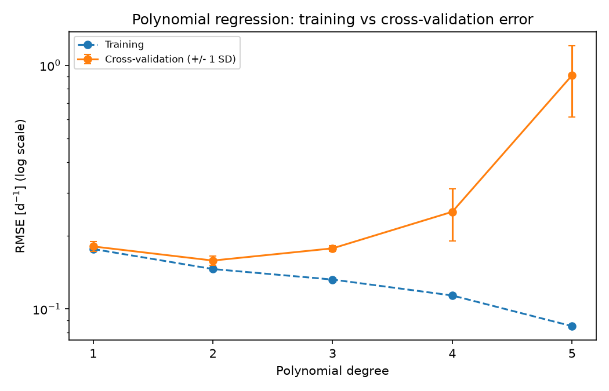
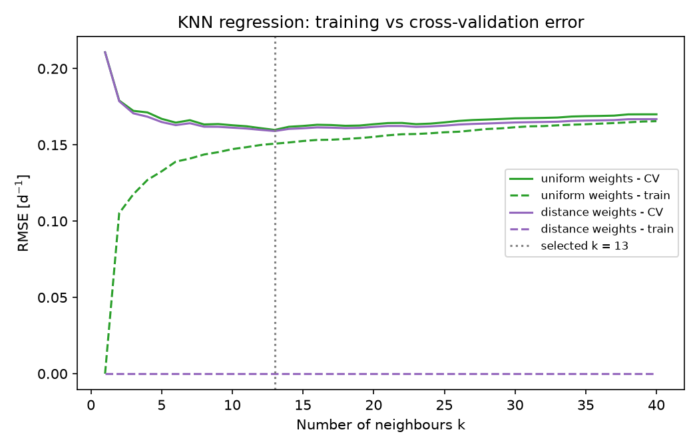
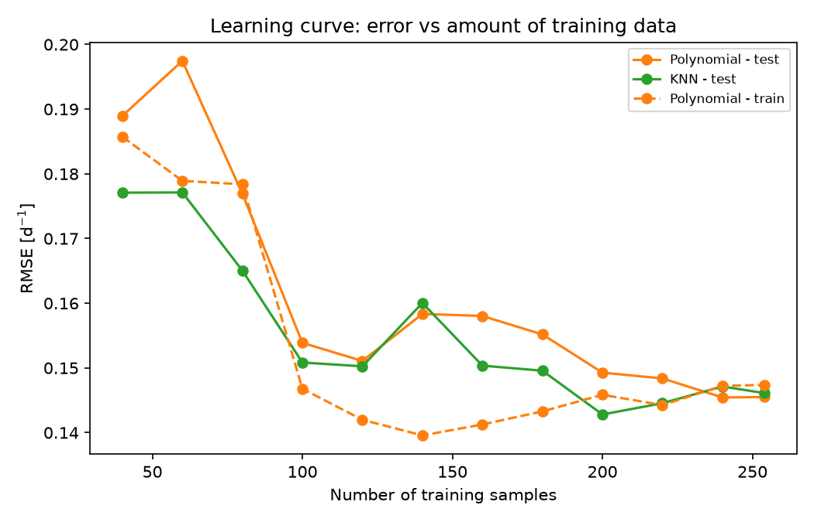
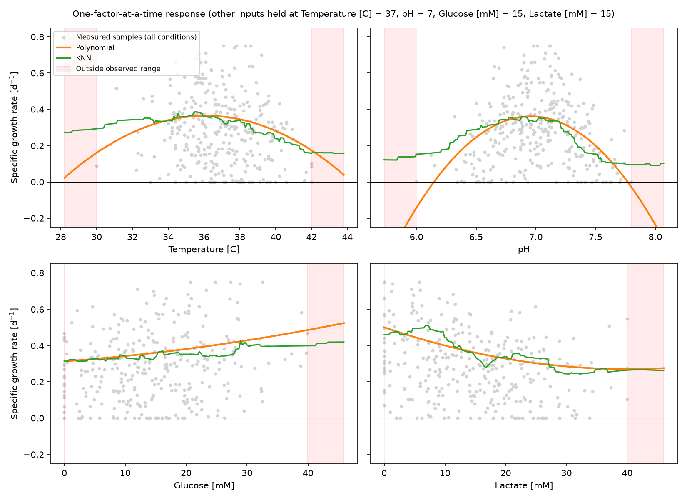

# Cell Culture Growth Rate Regression

This project predicts the specific growth rate of a mammalian cell culture from four process variables: temperature, pH, glucose concentration and lactate concentration. It tunes and compares polynomial and k-nearest-neighbour regression models with cross-validation, evaluates them on held-out samples, and uses the selected model to show how each variable affects growth and where predictions become unreliable. The result is a lightweight tool for exploring culture operating conditions.

## Highlights

- Built reproducible scikit-learn pipelines for scaling and regression
- Tuned polynomial and KNN models with cross-validated grid search
- Diagnosed underfitting and overfitting using validation and learning curves
- Evaluated tuned models on a held-out test set
- Visualized predicted growth responses to each culture variable

## Environment

- Python 3.14.7
- matplotlib 3.11.0
- numpy 2.5.2
- pandas 3.0.5
- scikit-learn 1.9.0

## Code Design

Running `python main.py` executes the full workflow, from the raw CSV to the exported tables and figures, in a few seconds. `main.py` only orchestrates the workflow. Fixed settings (random seed, number of folds, hyperparameter ranges and the reference culture condition) live in `src/constants.py`, so an experiment can be changed in one place. All reusable logic lives in `src/functions.py`. Both model families go through the same tuning and reporting functions, so they are always compared the same way.

### Loading the data

The workflow begins by reading `datasets/dataset_cell_growth_4factor.csv` into a pandas DataFrame. Each row is one culture sample, with the measured specific growth rate in the first column and the four culture conditions in the remaining columns. Loading is kept separate from every later step, so the raw table is read in one place and all preprocessing, such as scaling, happens inside the model pipelines where it can be fitted on training data only.

### Holding out a test set

Before any model sees the data, 20 % of the samples (64 of 318) are set aside as a test set using a fixed random seed. All hyperparameter tuning happens on the remaining 254 training samples. The test set is used once, at the end, so it gives an unbiased estimate of how the tuned models perform on new cultures. Without this separation, the hyperparameter search would indirectly learn from the test samples and the reported accuracy would be optimistic.

### Tuning the model families

Two model families are tuned with `GridSearchCV`. Each is built with scikit-learn's `make_pipeline` so that scaling is refit inside every cross-validation fold and never sees validation data.

- **Polynomial regression**: inputs are standardized, expanded into polynomial and interaction terms, and fitted with ordinary least squares. The search covers polynomial degrees 1 to 5.
- **K-nearest neighbours**: inputs are standardized so that glucose and lactate (measured in mM, spanning tens of units) do not dominate pH (spanning less than two units) in the distance calculation. The search covers k = 1 to 40 with uniform or distance weighting.

Every setting is scored with 4-fold cross-validation on the training set, recording both training and validation RMSE and R². Comparing training and validation error at each setting shows whether a model is underfitting or overfitting. Full results are exported to `tables/polynomial_cv_results.csv` and `tables/knn_cv_results.csv`, and validation curves are saved to `figures/polynomial_validation_curve.png` and `figures/knn_validation_curve.png`. The setting with the lowest validation RMSE in each family is refit on the full training set.

### Evaluating on the test set

The two tuned models are then scored once on the held-out test set. For each, the program reports R² and RMSE on both the training and test sets and exports them to `tables/model_evaluation.csv`. RMSE is reported in the same units as the growth rate (d⁻¹), so it reads directly as a typical prediction error, while R² shows what fraction of the variation in growth the model explains. Comparing training and test scores side by side shows how much each model has memorized rather than generalized.

### Checking whether more data would help

A learning curve shows how error changes as a model is given more training data. The program shuffles the training set once and takes nested subsets of 40, 60, … 240 samples and then the full 254, so each larger subset contains every smaller one. At each size, both model families are re-tuned with the same grid search and then scored on the same held-out test set. The results are exported to `tables/learning_curve.csv` and plotted in `figures/learning_curve.png`. This stage answers a question the validation curves cannot: whether the remaining error comes from too little data, which collecting more samples would fix, or from noise that no amount of data would remove.

### Exploring input effects

The final stage turns the fitted models into process insight. With four inputs, the model's predictions cannot be drawn in a single plot, and plotting the raw data against one input is misleading because the other three inputs vary from sample to sample at the same time. The program therefore uses one-variable sweeps. Each input is swept across its observed range, and slightly beyond it, while the other three are held at a reference condition close to the dataset medians (37 °C, pH 7.0, 15 mM glucose, 15 mM lactate). This isolates the effect of each variable as the model sees it. The medians are used because that is where the data is densest, so the fixed inputs sit where the model is most reliable. Both tuned models predict growth along each sweep, so places where they disagree reveal where the data does not constrain the answer. The program records where growth peaks, the predicted growth at each end of the range, and the total change in growth. These summaries are exported to `tables/feature_effects.csv`. The sweeps are plotted against the measured samples in `figures/feature_responses.png`, with the regions outside the observed data range shaded so that extrapolation is easy to spot.

### Exporting results

All tables are written to `tables/` and all figures to `figures/`, so every number quoted in the analysis below can be traced to a file produced by the code. When the run finishes, `main.py` prints a short summary of each tuned model's test-set scores, so the outcome can be checked without opening the files. Rerunning `main.py` regenerates every output from the raw data.

## Analysis

### Choosing the regression algorithm

The dataset is small (318 samples), has only four inputs, and is noisy. The growth rate has a standard deviation of about 0.19 d⁻¹, and the best models in this project leave a validation RMSE of about 0.16 d⁻¹, so much of the variation is not explained by the four measured variables. In this setting, the most useful model is one that captures the dominant trends smoothly, can be explained, and does not chase noise. A **degree-2 polynomial regression** was selected as the final model.

| Model | Best setting | Validation RMSE [d⁻¹] | Validation SD | Validation R² |
|---|---|---|---|---|
| Polynomial regression | degree 2 | 0.158 | 0.007 | 0.324 |
| K-nearest neighbours | k = 13, distance weights | 0.159 | 0.004 | 0.312 |

The polynomial model achieved the lowest validation error, but the margin over KNN (0.001 d⁻¹) is much smaller than the variation between folds. Accuracy alone therefore does not strongly separate the two families. The deciding factors are interpretability and smoothness. A degree-2 polynomial has only 14 terms: four linear, four squared and six pairwise interactions. Its squared terms directly represent the kind of optimum expected for temperature and pH in cell culture, and it produces smooth predictions in which a small change in conditions gives a small change in growth. KNN, by contrast, produces step-like responses, has no compact form that can be inspected, and must store the full training set to make predictions.

### Tuning the polynomial model

| Degree | Training RMSE | Validation RMSE | Validation R² |
|---|---|---|---|
| 1 | 0.176 | 0.181 | 0.112 |
| **2** | **0.146** | **0.158** | **0.324** |
| 3 | 0.132 | 0.177 | 0.147 |
| 4 | 0.114 | 0.251 | −0.863 |
| 5 | 0.085 | 0.909 | −24.97 |

The validation curve shows a clear bias–variance trade-off. A linear model (degree 1) underfits. Training and validation errors are both high and nearly equal, because a straight line cannot represent a growth optimum in temperature or pH. Moving to degree 2 gives the lowest validation error. Beyond degree 2, training error keeps falling while validation error rises: by degree 4 the validation R² is negative, and at degree 5 the error is almost six times that of degree 2. The higher-degree models have enough terms to fit noise in 254 samples, which hurts their predictions on new data. The small gap between training (0.146) and validation (0.158) RMSE at degree 2 shows that the selected model is not overfitting.

### Tuning the KNN model

KNN shows the same trade-off along a different axis. With k = 1, the model reproduces every training sample exactly but generalizes poorly (validation RMSE 0.211 d⁻¹). Error drops sharply up to about k = 5 and then flattens. The lowest error is at k = 13 with distance weighting (0.159 d⁻¹), and k = 40 rises again to 0.167 d⁻¹ as averaging over more neighbours starts to blur real trends. Distance weighting was slightly better than uniform weighting at nearly every k, but the difference is small. Because distance weighting gives each training point full weight at its own location, its training error is always zero. That makes the training curve uninformative and makes the uniform-weight training curve the better indicator of overfitting. The long, flat region between k = 10 and k = 25 (0.159–0.163 d⁻¹) suggests that KNN's accuracy is limited by noise in the data rather than by the choice of k.

### Performance on the test set

| Model | Training R² | Training RMSE | Test R² | Test RMSE |
|---|---|---|---|---|
| Polynomial (degree 2) | 0.416 | 0.147 | 0.221 | 0.146 |
| KNN (k = 13, distance) | 1.000 | 0.000 | 0.215 | 0.146 |

On the 64 held-out samples, the two models are practically tied (test RMSE 0.1455 versus 0.1461 d⁻¹), consistent with cross-validation. The polynomial model's training and test RMSE are almost identical, which confirms that it generalizes as expected. KNN's perfect training score is a feature of distance weighting, not evidence of a better fit. The test R² values are lower than the validation R² values, which is expected with only 64 test samples: a few unusual cultures can shift R² noticeably.

### Learning curve

The learning curve shows how both models improve as they are given more of the training data. Below 100 samples, the grid search selects a linear polynomial (degree 1). With so few samples it cannot yet distinguish real curvature from noise, so the polynomial model performs worse than KNN (test RMSE 0.18–0.20 versus 0.17–0.18 d⁻¹). From 100 samples onward, degree 2 is selected at every size and the polynomial's error drops sharply to about 0.15 d⁻¹. This confirms that the quadratic structure is real and appears consistently once enough data is available.

Beyond about 200 samples, both curves flatten at about 0.145 d⁻¹, and the polynomial's training and test errors meet (0.147 and 0.146 d⁻¹ at 254 samples). When training and test error converge and stop improving, the model is limited by noise in the data, not by sample size. Collecting more samples under the same conditions is therefore unlikely to reduce the error much. Measuring additional variables would be more useful. KNN's training error is not plotted because distance weighting reproduces every training sample exactly, which would put that line at zero at almost every size.

### Advantages and limitations

**Advantages.** The polynomial model is transparent: each effect is a single term that can be read and explained. It is smooth, which matters when comparing nearby set points. It matched KNN on validation and test error, trains almost instantly, and needs only its coefficients to make predictions.

**Limitations.** Accuracy is modest. About 30 % of the variance is explained, and the typical prediction error (test RMSE) is about 0.15 d⁻¹. This most likely reflects unmeasured factors (such as cell line, passage number or other nutrients) and measurement noise rather than a poor model choice, since KNN reached almost the same error and the learning curve shows no further improvement with more data. A quadratic is also symmetric about its peak and keeps curving outside the data. As the pH panel below shows, it predicts negative growth beyond the observed pH range. Within the data, it can be too steep near the edges and miss sharp drops to zero growth.

### How each culture variable affects growth

Each panel varies one input while the other three are held at the reference condition (37 °C, pH 7.0, 15 mM glucose, 15 mM lactate). The orange line is the polynomial model and the green line is KNN. The grey dots are all measured samples. They appear widely scattered because each sample also differs in the three inputs that are held fixed in the sweep, so they should not be expected to lie on the curves. One-variable sweeps were chosen because they separate the effect of each variable from the others, which a raw scatter plot cannot do, and because they can be read like a simple dose-response curve. Their limitation is that they show each effect at one reference condition only. Because the degree-2 model includes interaction terms, the size of an effect can differ somewhat at other conditions.

| Variable | Polynomial: value at peak | Polynomial: growth at min → max of range | KNN: growth at min → max of range |
|---|---|---|---|
| Temperature | 36.1 °C (0.37 d⁻¹) | 0.16 → 0.17 d⁻¹ (30 → 42 °C) | 0.29 → 0.16 d⁻¹ |
| pH | 6.96 (0.36 d⁻¹) | 0.00 → 0.00 d⁻¹ (pH 6.0 → 7.8) | 0.15 → 0.10 d⁻¹ |
| Glucose | 39.9 mM (0.49 d⁻¹) | 0.31 → 0.49 d⁻¹ (0 → 40 mM) | 0.31 → 0.40 d⁻¹ |
| Lactate | 0 mM (0.50 d⁻¹) | 0.50 → 0.27 d⁻¹ (0 → 40 mM) | 0.46 → 0.27 d⁻¹ |

**pH** has the largest effect. Predicted growth peaks near pH 6.96 and falls by 0.36 d⁻¹ toward either end of the observed range. Both models agree on the location of the optimum (6.96 and 6.90). **Temperature** also shows an optimum, near 36 °C, with a gentler decline. Growth falls by about half by 30 °C or 42 °C in the polynomial model, although KNN suggests the decline at low temperature is milder. **Lactate** acts as an inhibitor: raising it from 0 to 40 mM lowers predicted growth from about 0.50 to 0.27 d⁻¹, and both models agree closely. **Glucose** has a positive but weaker effect, increasing predicted growth by 0.17 d⁻¹ across its range.

### Conditions that give a high specific growth rate

The highest growth rates are predicted when temperature is near 35–37 °C, pH is between about 6.8 and 7.1, glucose is high (above roughly 20 mM) and lactate is low (below about 10 mM). The measured data agree: all 19 samples above 0.6 d⁻¹ have a pH between 6.65 and 7.19, and their median conditions are 37 °C, 20.7 mM glucose and 4.6 mM lactate. Because these effects add together in the model, a culture that meets all four conditions is predicted to grow faster than one that meets only some.

### Conditions that give a low specific growth rate

Low growth is predicted when pH drifts away from neutral (below about 6.5 or above about 7.5), when temperature is high (above about 40 °C), and when lactate has accumulated while glucose is depleted. The last case is typical of the late stage of a batch culture, where cells have consumed glucose and produced lactate. Within the observed ranges, pH excursions produce the largest predicted drop of any single variable.

### Where the model's predictions may not be reliable

- **Outside the observed ranges** (shaded in the response plot), the quadratic curves keep bending downward and quickly predict negative growth, most visibly for pH below 6.0 or above 7.8. Predictions there should not be used.
- **Near the edges of the observed ranges**, data is sparse and the two models disagree. At 30 °C, the polynomial predicts 0.16 d⁻¹ while KNN predicts 0.29 d⁻¹. At pH 6.0 and 7.8, the polynomial predicts zero while KNN predicts 0.10–0.15 d⁻¹. When two very different models disagree this much, the data does not constrain the answer.
- **Combinations of extreme conditions**, such as high temperature together with extreme pH, contain few training samples even when each variable is individually within range.
- **Individual cultures** can differ from predictions by about 0.15 d⁻¹ or more, because about 70 % of the variation is not explained by these four variables. The model is better suited to comparing conditions than to predicting one culture's exact growth rate.

### Applications

The most direct use is **screening culture set points before running experiments**. A process scientist can compare candidate temperature and pH set points, or glucose feeding targets, by predicted growth and run only the most promising conditions in the lab. The response curves also summarize process sensitivity: pH control deserves the tightest tolerance, while temperature is more forgiving near its optimum.

The glucose and lactate effects can support **fed-batch feeding decisions**. If at-line measurements show glucose falling and lactate rising, the model gives a rough estimate of how much growth is being lost, which can help justify a feed or a lactate-control strategy.

Finally, the model can guide **design of the next experiment**. The regions where predictions disagree or data is sparse, especially near the pH and temperature extremes, are exactly where new measurements would most improve the model.

## Repository Structure

- `main.py` runs the full workflow
- `src/constants.py` holds the random seed, number of folds, hyperparameter ranges, learning-curve sizes and the reference condition
- `src/functions.py` holds data loading, tuning, evaluation, learning-curve, sweep and plotting functions
- `datasets/` holds the raw culture data
- `tables/` holds the exported CSV results
- `figures/` holds the exported PNG figures
- `environment.yaml` holds the conda environment (`conda env create -f environment.yaml`)
